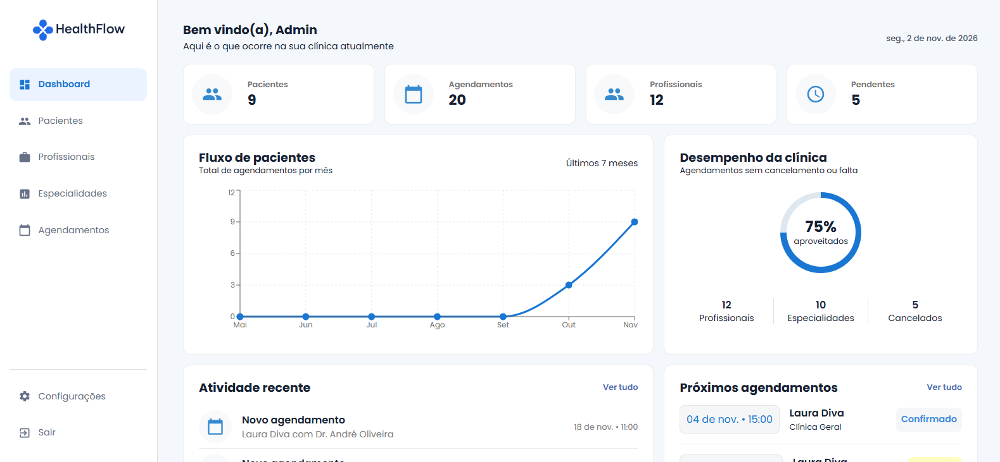
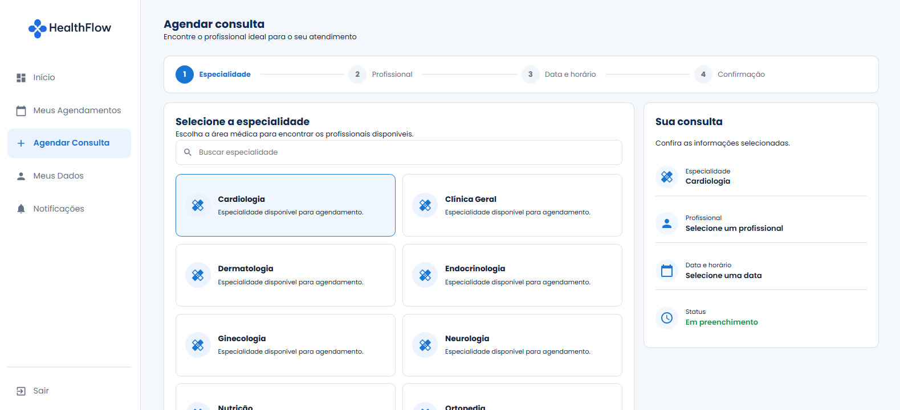
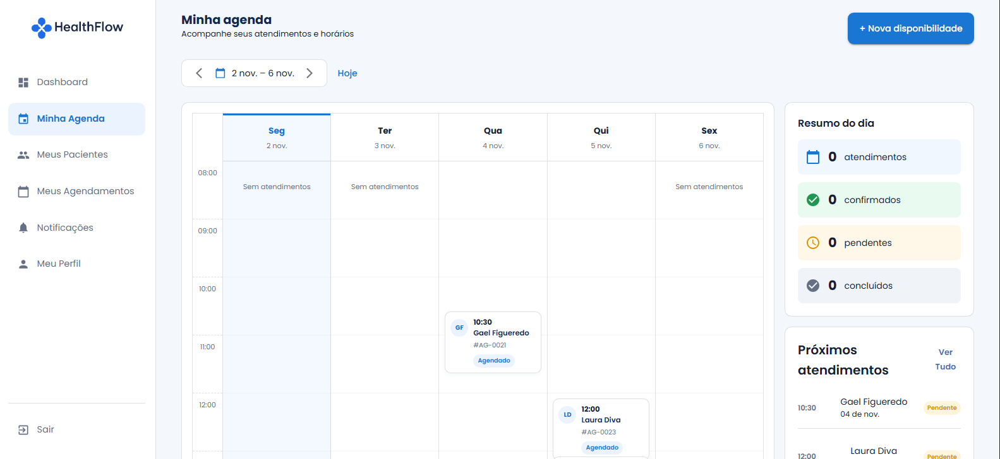

# HealthFlow

Plataforma web para gerenciamento de clínicas, profissionais, pacientes, especialidades e agendamentos.

O projeto foi desenvolvido como um projeto de portfólio, utilizando uma API em .NET e uma aplicação frontend em React. A plataforma possui autenticação com JWT e interfaces diferentes para administradores, profissionais e pacientes.

## Preview

<!-- Imagem 1: Dashboard administrativo -->


<!-- Imagem 2: Tela de agendamento do paciente -->


<!-- Imagem 3: Agenda do profissional -->


> Para adicionar as imagens, crie a pasta `docs/images` e coloque os arquivos com os nomes indicados acima. Caso prefira, substitua os caminhos pelas imagens utilizadas no seu projeto.

## Funcionalidades

### Autenticação

- Cadastro público de usuários como pacientes;
- Login com e-mail e senha;
- Autenticação utilizando JWT;
- Redirecionamento conforme o perfil do usuário;
- Controle de acesso por função;
- Logout com limpeza dos dados armazenados no navegador.

### Administrador

- Visualização do dashboard da clínica;
- Gerenciamento de pacientes;
- Gerenciamento de profissionais;
- Gerenciamento de especialidades;
- Gerenciamento de agendamentos;
- Cadastro de profissionais;
- Cadastro de especialidades;
- Cadastro de pacientes;
- Cadastro de agendamentos;
- Configurações da clínica.

### Profissional

- Dashboard profissional;
- Visualização da agenda;
- Visualização dos próprios agendamentos;
- Filtros por paciente, especialidade e status;
- Gerenciamento de disponibilidade;
- Perfil profissional;
- Visualização dos pacientes relacionados aos atendimentos.

### Paciente

- Página inicial com resumo dos atendimentos;
- Visualização de especialidades;
- Escolha de profissional;
- Visualização de datas disponíveis;
- Visualização de horários disponíveis;
- Confirmação de consulta;
- Visualização dos próprios agendamentos;
- Cancelamento de consulta, quando permitido;
- Visualização e edição dos dados pessoais;
- Central de notificações.

## Tecnologias utilizadas

### Backend

- .NET 10;
- ASP.NET Core Web API;
- Entity Framework Core;
- SQL Server LocalDB;
- JWT Bearer Authentication;
- Swagger/OpenAPI;
- xUnit;
- Moq.

### Frontend

- React;
- TypeScript;
- Vite;
- Material UI;
- Axios;
- React Router;
- React Toastify;
- Emotion Styled.

## Estrutura do projeto

```text
HealthFlow/
├── HealthFlow.Api/
│   ├── Controllers/
│   ├── Middlewares/
│   ├── Program.cs
│   └── appsettings.json
│
├── HealthFlow.Data/
│   ├── Contexts/
│   └── Migrations/
│
├── HealthFlow.Model/
│   ├── Entities/
│   ├── DTOs/
│   └── Enums/
│
├── HealthFlow.Repository/
│   ├── Interfaces/
│   └── Repositories/
│
├── HealthFlow.Service/
│   ├── Interfaces/
│   ├── Services/
│   └── Exceptions/
│
└── HealthFlow.Tests/
    └── Services/
```

Estrutura principal do frontend:

```text
src/
├── assets/
├── auth/
├── components/
├── hooks/
├── pages/
├── routes/
├── services/
├── theme/
├── App.tsx
└── main.tsx
```

As páginas seguem uma organização baseada em arquivos específicos:

```text
NomeDaPagina/
├── NomeDaPagina.tsx
├── NomeDaPagina.hook.ts
├── NomeDaPagina.styled.ts
├── NomeDaPagina.types.ts
└── NomeDaPagina.utils.ts
```

## Pré-requisitos

Antes de executar o projeto, instale:

- .NET SDK 10;
- Node.js;
- npm ou pnpm;
- SQL Server LocalDB;
- Visual Studio ou Visual Studio Code.

Para verificar as instalações:

```bash
dotnet --version
node --version
npm --version
```

## Configuração do banco de dados

O backend utiliza o SQL Server LocalDB. A connection string de desenvolvimento fica no arquivo:

```text
HealthFlow.Api/appsettings.Development.json
```

Exemplo:

```json
{
  "ConnectionStrings": {
    "HealthFlowConnection": "Server=(localdb)\\MSSQLLocalDB;Database=HealthFlowDb;Trusted_Connection=True;TrustServerCertificate=True;MultipleActiveResultSets=True"
  }
}
```

A API utiliza o banco `HealthFlowDb`.

## Como executar o backend

Abra o terminal na pasta raiz do backend:

```cmd
cd /d C:\Users\SEU_USUARIO\source\repos\HealthFlow
```

Restaure as dependências:

```cmd
dotnet restore
```

Aplique as migrations:

```cmd
dotnet ef database update --project HealthFlow.Data --startup-project HealthFlow.Api
```

Execute a API:

```cmd
dotnet run --project HealthFlow.Api
```

A URL exibida no terminal será algo parecido com:

```text
http://localhost:5135
```

A porta pode ser diferente na sua máquina. Utilize a porta exibida no terminal.

### Swagger

Com a API em execução, acesse:

```text
http://localhost:5135/swagger
```

Substitua `5135` pela porta apresentada no seu terminal, caso seja diferente.

Para testar endpoints protegidos no Swagger:

1. Faça login pelo endpoint de autenticação;
2. Copie o token retornado;
3. Clique em **Authorize**;
4. Informe:

```text
Bearer SEU_TOKEN
```

5. Clique em **Authorize**.

## Como executar o frontend

Abra outro terminal na pasta do frontend:

```cmd
cd /d C:\caminho\para\healthflow-web
```

Instale as dependências:

```cmd
npm install
```

Execute o projeto:

```cmd
npm run dev
```

O Vite exibirá uma URL semelhante a:

```text
http://localhost:5173
```

Abra essa URL no navegador.

## Configuração do Axios

O frontend utiliza uma instância centralizada do Axios em:

```text
src/services/api.ts
```

Exemplo de configuração:

```ts
import axios from "axios";

export const api = axios.create({
  baseURL: "http://localhost:5135/api",
});

api.interceptors.request.use((config) => {
  const token = localStorage.getItem("token");

  if (token) {
    config.headers.Authorization = `Bearer ${token}`;
  }

  return config;
});
```

Se a API estiver rodando em outra porta, atualize o `baseURL`.

## Fluxo de utilização

### Cadastro e login

O cadastro público cria um usuário com a role `Patient`. Após o cadastro, o usuário pode realizar login e acessar a área do paciente.

O login retorna informações como:

```json
{
  "userId": 1,
  "patientId": 1,
  "name": "Nome do usuário",
  "email": "usuario@email.com",
  "role": "Patient",
  "token": "jwt-token"
}
```

O token e os identificadores são armazenados no `localStorage` para manter a autenticação no frontend.

### Agendamento do paciente

O fluxo de agendamento segue estas etapas:

```text
Escolher especialidade
        ↓
Escolher profissional
        ↓
Buscar disponibilidade
        ↓
Escolher data
        ↓
Escolher horário
        ↓
Confirmar consulta
```

A confirmação envia os dados para:

```http
POST /api/appointments
```

Exemplo:

```json
{
  "patientId": 1,
  "professionalId": 1,
  "scheduledAt": "2026-10-20T08:00:00",
  "notes": null
}
```

## Principais endpoints

### Autenticação

```http
POST /api/auth/register
POST /api/auth/login
```

### Especialidades

```http
GET /api/specialties
GET /api/specialties/{id}
POST /api/specialties
```

### Profissionais

```http
GET /api/professionals
GET /api/professionals/{id}
POST /api/professionals
```

### Disponibilidade profissional

```http
GET /api/professionals/{id}/availability
POST /api/professionals/{id}/availability
```

### Agendamentos

```http
GET /api/appointments
GET /api/appointments/{id}
POST /api/appointments
PUT /api/appointments/{id}/confirm
PUT /api/appointments/{id}/cancel
PUT /api/appointments/{id}/complete
```

Os endpoints disponíveis podem variar conforme a versão atual do backend. A documentação oficial da API está disponível no Swagger.

## Testes

Para executar os testes automatizados:

```cmd
dotnet test
```

Para executar somente os testes do projeto:

```cmd
dotnet test HealthFlow.Tests
```

## Problemas comuns

### A API não inicia

Verifique:

- Se o SQL Server LocalDB está instalado;
- Se a connection string aponta para `HealthFlowDb`;
- Se a porta da API já está sendo utilizada;
- Se a chave JWT está configurada no `appsettings.Development.json`.

### Erro de CORS

Confira se o frontend está sendo executado em:

```text
http://localhost:5173
```

E se essa origem está liberada na configuração de CORS da API.

### Erro 401 Unauthorized

Faça login novamente e confirme se o token foi armazenado no `localStorage`. No Swagger, informe o token no formato:

```text
Bearer SEU_TOKEN
```

### Erro ao conectar com a API

Confira:

- Se a API está rodando;
- Se a porta usada no `src/services/api.ts` é a mesma exibida pelo backend;
- Se o endpoint começa com `/api`;
- Se o navegador não está bloqueando a requisição por CORS.

## Convenções de commit

O projeto utiliza Conventional Commits, com o tipo em inglês e a descrição em português:

```text
feat: adiciona confirmação de consulta
fix: corrige cadastro automático de pacientes
docs: atualiza documentação do projeto
refactor: reorganiza serviço de autenticação
test: adiciona testes do serviço de agendamento
```

## Objetivo do projeto

O HealthFlow foi desenvolvido para demonstrar conhecimentos em:

- Desenvolvimento de APIs REST;
- Arquitetura organizada em camadas;
- Autenticação e autorização com JWT;
- Integração entre frontend e backend;
- Persistência de dados com Entity Framework Core;
- Desenvolvimento de interfaces responsivas;
- Criação de fluxos diferentes por perfil de usuário;
- Testes unitários com mocks.

## Licença

Este projeto foi desenvolvido para fins educacionais e de portfólio.
